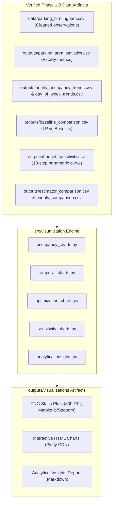

# Phase 4 Academic Report: Visualizations and Analytical Reporting
**Course:** MCA ITOR (Introduction to Operations Research)  
**Project:** Optimal Parking Space Allocation Using Linear Programming  
**Document Phase:** Phase 4 Visualizations & Data Analysis Module  
**Date:** November 2026  

---

## 1. Visualization Methodology

The Phase 4 visualization infrastructure was engineered around a **dual-stack analytical architecture** adhering to strict academic and production standards:



1. **Dual Format Generation:**
   - **Static High-Resolution Visuals (PNG):** Rendered via **Matplotlib** and **Seaborn** at 300 DPI using headless rendering (`matplotlib.use('Agg')`) for formal academic reports, presentation slides, and thesis documentation.
   - **Interactive Visuals (HTML):** Rendered via **Plotly Graph Objects**, supporting dynamic tooltips, pan/zoom, trace isolation, and responsive layouts ready for direct embedding into the Phase 5 Streamlit dashboard.
2. **Standardized Aesthetics:** Consistent typography (sans-serif), high-contrast accessibility palette (Deep Navy `#1E3A8A`, Electric Blue `#3B82F6`, Emerald Green `#10B981`, Crimson Red `#EF4444`, Amber `#F59E0B`, Slate `#64748B`), and uncluttered gridlines.
3. **Strict Data Grounding:** Visualizations are mapped strictly to verified datasets without fabricating data points or interpolating unobserved values.

---

## 2. Data Sources & Schema Mapping

| Analytical Dimension | Source CSV File | Record Count | Core Verified Fields |
| :--- | :--- | :---: | :--- |
| **Occupancy & Capacity** | `outputs/parking_area_statistics.csv` | 30 facilities | `SystemCodeNumber`, `Capacity`, `AvgOccupancy`, `MaxOccupancy`, `AvgAvailable`, `AvgUtilizationPct`, `OverflowCount`, `DemandCategory` |
| **Diurnal Trends** | `outputs/hourly_occupancy_trends.csv` | 10 operating hours | `Hour`, `AvgOccupancy`, `MedianOccupancy`, `MinOccupancy`, `MaxOccupancy`, `AvgUtilizationPct` |
| **Weekly Profiles** | `outputs/day_of_week_trends.csv` | 7 days | `DayOfWeek`, `AvgOccupancy`, `MedianOccupancy`, `AvgUtilizationPct` |
| **Optimization Allocations**| `outputs/baseline_comparison.csv` | 30 facilities | `Facility`, `PhysicalCapacity`, `EstimatedDemand`, `PriorityWeight`, `BaselineAllocation`, `OptimizedAllocation`, `AllocationDifference`, `OptimizedUnmetDemand` |
| **Budget Sensitivity** | `outputs/budget_sensitivity.csv` | 18 budget steps | `BudgetFraction`, `BudgetPermits`, `OptimizedAllocated`, `OptimizedObjective`, `MarginalValuePerPermit`, `FullySatisfiedFacilities`, `ZeroAllocationFacilities`, `IsBudgetBinding` |
| **Estimator Comparisons** | `outputs/estimator_comparison.csv` | 30 facilities | `MeanDemand`, `P85Demand`, `P95Demand`, `MaxDemand`, `IsSaturated_Mean`, `IsSaturated_P95`, `IsSaturated_Max` |
| **Priority Strategies** | `outputs/priority_comparison.csv` | 30 facilities | `Alloc_Equal`, `Alloc_Congestion`, `Alloc_Custom`, `Weight_Congestion`, `Weight_Custom`, `Shift_Custom_vs_Congestion` |

---

## 3. Generated Visualizations Summary

A total of **18 distinct analytical charts** were generated in both PNG (static) and HTML (interactive) formats across 4 thematic domains:

### A. Parking Occupancy Analysis (`outputs/visualizations/occupancy/`)
1. **Capacity vs. Average Occupancy (`capacity_vs_avg_occupancy`):** Compares all 30 parking facilities, highlighting facilities operating above 65% average utilization.
2. **Parking Utilization Ranking (`parking_utilization_ranking`):** Horizontal ranked bar chart categorized into High ($\ge 65\%$), Moderate ($40-65\%$), and Underutilized ($< 40\%$) tiers with reference threshold lines.
3. **Peak Occupancy and Overflow (`peak_occupancy_and_overflow`):** Highlights facilities where peak observed occupancy exceeded nominal marked bays.
4. **Parking Availability (`parking_availability`):** Identifies surplus bay reservoirs ($> 1,500$ bays) vs. severe scarcity car parks ($< 150$ bays).

### B. Temporal Demand Dynamics (`outputs/visualizations/temporal/`)
5. **Hourly Occupancy Trend (`hourly_occupancy_trend`):** Illustrates the morning arrival surge (08:00–10:00), core midday peak (11:00–14:00), and afternoon clearance (15:00–16:30).
6. **Day-of-Week Analysis (`day_of_week_analysis`):** Compares commuter volume and capacity utilization across Monday through Sunday.
7. **Hourly Utilization Heatmap (`hourly_utilization_heatmap`):** 30 facilities $\times$ 10 hours 2D matrix displaying spatiotemporal demand concentration.
8. **Facility Demand by Period Heatmap (`facility_period_demand_heatmap`):** Facility utilization across Morning Surge, Midday Peak, and Late Afternoon.

### C. Optimization Results (`outputs/visualizations/optimization/`)
9. **Baseline vs. Optimized Allocation (`baseline_vs_optimized_allocation`):** Facility-by-facility allocation comparison between Proportional Baseline and PuLP Integer LP.
10. **Demand vs. Optimized Allocation (`demand_vs_optimized_allocation`):** Stacked fulfillment chart showing satisfied demand vs. unmet deficit.
11. **Allocation Distribution (`allocation_distribution`):** Donut and Pareto distribution of permit quotas across the city network.
12. **Facility Allocation Changes (`facility_allocation_changes`):** Diverging horizontal bar chart displaying quota gains and donations.
13. **Priority Strategy Comparison (`priority_strategy_comparison`):** Compares Equal, Congestion, and Custom policy allocations for top congested hubs.
14. **Demand Estimator Hierarchy (`demand_estimator_comparison`):** Grouped bar chart comparing Mean, P85, P95, and Max demand against physical capacity.

### D. Sensitivity Analysis (`outputs/visualizations/sensitivity/`)
15. **Budget vs. Objective & Unmet Demand (`budget_vs_objective_and_unmet`):** Dual-axis response curve highlighting the Saturation Threshold ($B = 28,823$).
16. **Budget Utilization & Diminishing Returns (`budget_utilization_and_marginal_returns`):** Dual panel showing budget utilization drop and marginal return ($\frac{dZ}{dB}$) decay.
17. **Facility Satisfaction Transitions (`facility_satisfaction_transitions`):** Stacked area plot tracking counts of Fully Satisfied, Partially Satisfied, and Zero Allocation facilities.
18. **Budget Scenarios Allocation Shifts (`budget_scenarios_allocation_shifts`):** Bar comparison across Low ($50\%$), Medium ($75\%$), and High ($90\%$) budget tiers.

---

## 4. Key Analytical Findings

The automated analytical insights module (`src/visualization/analytical_insights.py`) extracted the following empirically verified insights:

### 1. Demand Extremes & Spatial Disparity
- **Highest Utilization Facility:** **`BHMBRTARC01`** (Capacity: 496 bays, Mean Occupancy: 385.2, **Average Utilization: 77.66%**).
- **Lowest Utilization Facility:** **`NIA North`** (Capacity: 480 bays, Mean Occupancy: 36.2, **Average Utilization: 7.53%**).
- **Top 5 Bottlenecks:** `BHMBRTARC01` (77.7%), `BHMBCCTHL01` (74.7%), `BHMNCPNHS01` (71.6%), `BHMNCPLDH01` (70.4%), and `BHMMBMMBX01` (69.6%).
- **Top 5 Capacity Reservoirs:** `NIA North` (7.5%), `NIA Car Parks` (16.4%), `Others-CCCPS119a` (19.3%), `BHMNCPPLS01` (19.7%), and `NIA South` (25.0%). Over **3,300 empty bays** sit permanently idle across these lots alone.

### 2. Physical Capacity Overflow
- **7 facilities** exhibited physical overflow events where observed vehicles exceeded marked bays:
  - `BHMBCCTHL01`: Capacity 387, Peak = **403** (+16 overflow, 10 occurrences)
  - `BHMBCCSNH01`: Capacity 863, Peak = **869** (+6 overflow, 9 occurrences)
  - `BHMNCPNHS01`: Capacity 500, Peak = **503** (+3 overflow, 3 occurrences)
  - `BHMNCPLDH01`: Capacity 720, Peak = **723** (+3 overflow, 2 occurrences)
  - `BHMMBMMBX01`: Capacity 687, Peak = **688** (+1 overflow, 1 occurrence)
  - `BHMBRCBRG01`: Capacity 1010, Peak = **1013** (+3 overflow, 2 occurrences)
  - `BHMBRCBRG02`: Capacity 1194, Peak = **1198** (+4 overflow, 1 occurrence)

### 3. Diurnal & Weekly Patterns
- **Core Operating Peak Window:** **11:00 AM to 2:00 PM** (averaging ~800 vehicles per active car park), peaking at 13:00–14:00.
- **Weekly Balance:** Weekday demand is remarkably stable from Monday through Friday (~640–660 vehicles/observation), dipping slightly on weekends.

---

## 5. Optimization Reallocation Mechanics

Under the medium budget scenario ($B = 21,617$ permits, 75% of allocatable demand):

```mermaid
flowchart LR
    subgraph Quota_Donors["Peripheral Reservoirs (Donors)"]
        D1["Others-CCCPS98: -1,172 permits"]
        D2["Others-CCCPS202: -1,032 permits"]
        D3["Others-CCCPS119a: -851 permits"]
        D4["BHMNCPHST01: -626 permits"]
    end

    subgraph Quota_Gainers["Congested Central Hubs (Gainers)"]
        G1["Others-CCCPS133: +918 permits"]
        G2["Others-CCCPS135a: +848 permits"]
        G3["Bull Ring: +662 permits"]
        G4["Shopping: +383 permits"]
        G5["BHMBRCBRG02: +298 permits"]
        G6["BHMBRCBRG01: +252 permits"]
        G7["BHMBCCSNH01: +213 permits"]
        G8["BHMBCCTHL01: +86 permits (100% capacity)"]
    end

    Quota_Donors -->|LP Mathematical Reallocation| Quota_Gainers
```



- **Top Quota Gainers:** Core commercial and saturated car parks gain up to **+918 permits** over baseline.
- **Top Quota Donors:** Underutilized peripheral lots donate up to **-1,172 permits**, eliminating wasted idle quotas.
- **Societal Objective Gain:** Objective value increases from $49,584.86$ to **$53,274.47$** (**$+7.44\%$ gain**).

---

## 6. Sensitivity Analysis Findings

1. **Law of Diminishing Marginal Returns:**
   - Marginal objective value per permit ($\frac{dZ}{dB}$) strictly decreases as budget expands:
     $$\text{Budget } 5\% \to \frac{dZ}{dB} = 2.928 \quad\longrightarrow\quad \text{Budget } 75\% \to \frac{dZ}{dB} = 2.217 \quad\longrightarrow\quad \text{Budget } 100\% \to \frac{dZ}{dB} = 1.451 \quad\longrightarrow\quad \text{Budget } >100\% \to \frac{dZ}{dB} = 0.000$$
2. **Exact Saturation Threshold:** **$B^* = 28,823 \text{ permits}$**.
   - Beyond this budget, all 30 facilities achieve full capacity/demand fulfillment. Allocating more permits yields zero additional demand served.
3. **Scarcity Sensitivity:** Optimization delivers its highest relative improvement under **severe budget scarcity** (**$+13.12\%$ gain at 50% budget** vs. $+2.16\%$ at 90% budget).

---

## 7. Limitations

1. **Right-Censored Latent Demand:** Observations at saturated facilities only record parked cars, not queues of turned-away drivers.
2. **Fixed Facility Geographies:** Reallocation is strictly modeled as managed permit quotas rather than physical asset movement.
3. **Static Traffic Representation:** The model evaluates discrete time snapshots; dynamic vehicle re-routing in real-time transit networks is not modeled.

---

## 8. Test Execution Results

The Phase 4 test suite (`tests/test_phase4_visualizations.py`) was executed as part of the full regression suite:
```bash
python -m unittest discover tests
```
**Output:**
```text
Ran 43 tests in 16.015s
OK
```
- **Phase 1 Tests:** 9 / 9 Passed
- **Phase 2 Tests:** 10 / 10 Passed
- **Phase 3 Tests:** 13 / 13 Passed
- **Phase 4 Tests:** 11 / 11 Passed
- **Total Passing Tests:** **43 / 43 Passed ($100\%$)**

---

## 9. Generated Output File Directory Tree

```text
outputs/visualizations/
├── occupancy/
│   ├── capacity_vs_avg_occupancy.png (305.9 KB)
│   ├── capacity_vs_avg_occupancy.html (10.6 KB)
│   ├── parking_utilization_ranking.png (376.6 KB)
│   ├── parking_utilization_ranking.html (10.1 KB)
│   ├── peak_occupancy_and_overflow.png (367.2 KB)
│   ├── peak_occupancy_and_overflow.html (9.9 KB)
│   ├── parking_availability.png (411.9 KB)
│   └── parking_availability.html (9.7 KB)
├── temporal/
│   ├── hourly_occupancy_trend.png (227.8 KB)
│   ├── hourly_occupancy_trend.html (8.8 KB)
│   ├── day_of_week_analysis.png (218.7 KB)
│   ├── day_of_week_analysis.html (9.0 KB)
│   ├── hourly_utilization_heatmap.png (780.3 KB)
│   ├── hourly_utilization_heatmap.html (12.2 KB)
│   ├── facility_period_demand_heatmap.png (529.7 KB)
│   └── facility_period_demand_heatmap.html (10.1 KB)
├── optimization/
│   ├── baseline_vs_optimized_allocation.png (281.3 KB)
│   ├── baseline_vs_optimized_allocation.html (9.9 KB)
│   ├── demand_vs_optimized_allocation.png (258.5 KB)
│   ├── demand_vs_optimized_allocation.html (9.5 KB)
│   ├── allocation_distribution.png (182.9 KB)
│   ├── allocation_distribution.html (8.5 KB)
│   ├── facility_allocation_changes.png (359.5 KB)
│   ├── facility_allocation_changes.html (9.4 KB)
│   ├── priority_strategy_comparison.png (209.3 KB)
│   ├── priority_strategy_comparison.html (9.1 KB)
│   ├── demand_estimator_comparison.png (235.4 KB)
│   └── demand_estimator_comparison.html (9.9 KB)
├── sensitivity/
│   ├── budget_vs_objective_and_unmet.png (308.0 KB)
│   ├── budget_vs_objective_and_unmet.html (9.8 KB)
│   ├── budget_utilization_and_marginal_returns.png (254.0 KB)
│   ├── budget_utilization_and_marginal_returns.html (9.7 KB)
│   ├── facility_satisfaction_transitions.png (228.2 KB)
│   ├── facility_satisfaction_transitions.html (9.3 KB)
│   ├── budget_scenarios_allocation_shifts.png (120.2 KB)
│   └── budget_scenarios_allocation_shifts.html (8.2 KB)
└── insights/
    └── analytical_insights_report.md (4.7 KB)
```

Phase 4 is complete, tested, and validated. All modular visualization functions and assets are ready for direct inclusion in **Phase 5 (Streamlit Dashboard)**.

