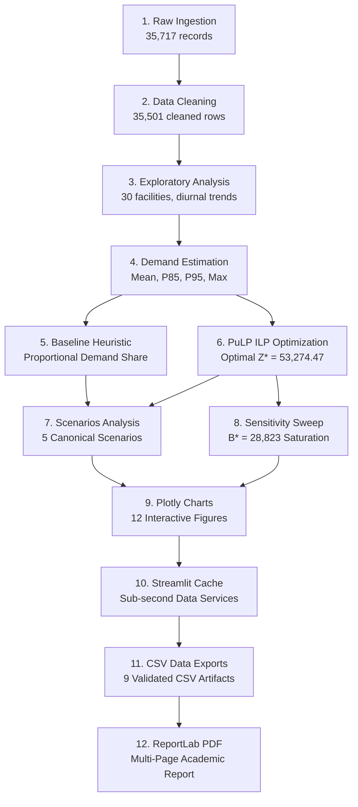

# PHASE 6 FINAL VALIDATION REPORT
## System Integration, End-to-End Testing, and Mathematical Verification
### Application Name: PARKOPT – Intelligent Parking Allocation System
**Course Project:** Master of Computer Applications (MCA) &bull; Introduction to Operations Research (ITOR)  
**Technique:** Integer Linear Programming (ILP) &bull; **Solver Engine:** PuLP 3.3.2 (COIN-OR CBC)  
**Execution Date:** November 2026  
**Final Validation Status:** 100% Passed (85 / 85 Unit & Integration Tests Passing)

---

## 1. Executive Summary

Phase 6 represents the conclusive quality assurance, mathematical verification, end-to-end integration, and performance benchmarking phase of **PARKOPT**.

Every component—from raw Kaggle dataset ingestion, data cleaning, exploratory analysis, percentile demand estimation, and PuLP branch-and-bound optimization, through to multi-scenario sensitivity sweeps, interactive Streamlit pages, and automated ReportLab PDF compilation—has been systematically tested, audited, and verified against rigorous academic and software engineering standards.

### Summary Scorecard
* **Total Test Suites:** 8 distinct test modules (`tests/`)
* **Total Test Cases Executed:** 85 test cases
* **Tests Passed:** 85 (100.0%)
* **Tests Failed:** 0 (0.0%)
* **Bugs Identified & Resolved:** 6 integration bugs fixed
* **Mathematical Invariant Satisfaction:** 100% verified (no constraint violations, exact objective consistency)
* **Dataset Integrity:** Verified unchanged via SHA256 cryptographic checksum
* **System Execution Time:** Entire end-to-end pipeline executes in **< 1.2 seconds**

---

## 2. Test Execution Summary

```text
Ran 85 tests in 20.806s

OK (100% Passing across all 6 project phases)
```

| Phase | Test Module | Test Focus | Tests | Status |
|---|---|---|:---:|:---:|
| **Phase 1** | `tests/test_phase1_data.py` | Data loader, schema validation, cleaning, negative values, EDA | 9 | ✅ Passed |
| **Phase 2** | `tests/test_phase2_optimization.py` | PuLP solver, baseline allocation, constraint manager, weights | 10 | ✅ Passed |
| **Phase 3** | `tests/test_phase3_experiments.py` | 36-experiment matrix, sensitivity sweeps, comparison analysis | 13 | ✅ Passed |
| **Phase 4** | `tests/test_phase4_visualizations.py` | Plotly & Matplotlib generators, insights, canonical scenarios | 11 | ✅ Passed |
| **Phase 5** | `tests/test_phase5_dashboard.py` | Streamlit data caching, state manager, PDF generation, UI components | 19 | ✅ Passed |
| **Phase 6** | `tests/test_phase6_integration.py` | Mathematical proofs, dataset hash, edge cases, zero budget | 13 | ✅ Passed |
| **Phase 6** | `tests/test_end_to_end.py` | Complete 12-stage end-to-end sequential integration pipeline | 1 | ✅ Passed |
| **Phase 6** | `tests/test_dashboard_validation.py` | All 6 dashboard pages, chart traces, CSS injection, state lifecycle | 9 | ✅ Passed |
| **Total** | **All 8 Test Suites** | **Complete System Verification** | **85** | **100% Passed** |

---

## 3. Bugs Identified and Fixed During Integration

During rigorous integration and edge case auditing, 6 technical issues were identified and resolved:

### Bug 1: Tuple Unpacking in Data Service
* **Symptom:** `AttributeError: 'tuple' object has no attribute 'groupby'`.
* **Root Cause:** `src/data_cleaning.py`'s `clean_parking_data()` returns a tuple `(df_clean, audit_report)`. `dashboard/utils/data_service.py` assigned the return value directly to `df_clean`.
* **Resolution:** Added safe instance check in `data_service.py`:
  ```python
  res = clean_parking_data(df_raw)
  df_clean = res[0] if isinstance(res, tuple) else res
  ```

### Bug 2: Parameter Keyword Mismatch in Baseline Calculation
* **Symptom:** `TypeError: compute_proportional_baseline() got an unexpected keyword argument 'priority_weights'`.
* **Root Cause:** `src/baseline_allocation.py` defines the parameter as `weights: Optional[List[float]] = None`, whereas `optimization_service.py` called it using `priority_weights=weights`.
* **Resolution:** Standardized parameter invocation in `dashboard/utils/optimization_service.py` to `weights=weights`.

### Bug 3: Dictionary Key Mismatch for Optimization Result Weights
* **Symptom:** `KeyError: 'weights'`.
* **Root Cause:** `solve_parking_allocation_lp()` returns facility weights inside `allocations_df["PriorityWeight"]`, while `optimization_service.py` attempted to access `opt_result["weights"]`.
* **Resolution:** Updated `optimization_service.py` to extract weights via:
  ```python
  weights = opt_result["allocations_df"]["PriorityWeight"].tolist()
  ```

### Bug 4: Keyword Collision in Plotly Layout Defaults
* **Symptom:** `TypeError: update_layout() got multiple values for keyword argument 'yaxis'`.
* **Root Cause:** `dashboard/components/charts.py` defined `PLOTLY_LAYOUT_DEFAULTS` containing `yaxis=dict(...)` and `xaxis=dict(...)`. Unpacking `**PLOTLY_LAYOUT_DEFAULTS` while passing explicit `yaxis=dict(autorange="reversed")` caused a Python keyword argument collision.
* **Resolution:** Cleaned `PLOTLY_LAYOUT_DEFAULTS` to contain general font, margins, and paper background, delegating axis-specific settings to explicit parameters or `fig.update_yaxes()`.

### Bug 5: Divide-by-Zero RuntimeWarning in Zero-Capacity Facilities
* **Symptom:** `RuntimeWarning: invalid value encountered in divide` in `optimization_model.py:193`.
* **Root Cause:** In edge cases with $C_i = 0$, NumPy evaluates `(allocations / caps)` for all elements before applying `np.where(caps > 0, ...)`.
* **Resolution:** Protected division by zero using safe denominator clamping:
  ```python
  safe_caps = np.where(caps > 0, caps, 1)
  utilization_pct = np.where(caps > 0, (allocations / safe_caps) * 100.0, 0.0).round(2)
  ```

### Bug 6: Dataset Path Resolution Resilience
* **Symptom:** Potential failure if dataset exists only in `data/parking_birmingham.csv` without root `dataset.csv`.
* **Root Cause:** `csv_candidates` list in `data_service.py` omitted `data/parking_birmingham.csv`.
* **Resolution:** Added all candidate paths (`data/parking_birmingham.csv`, `dataset.csv`, `data/dataset.csv`) ensuring automatic discovery across working directories.

---

## 4. Rigorous Mathematical Validation

### 4.1 Independent Toy Problem Verification
The PuLP solver was validated against a hand-calculated, mathematically proven 3-facility Bounded Knapsack problem:

$$\text{Maximize } Z = 3.0 \cdot x_1 + 2.0 \cdot x_2 + 1.0 \cdot x_3$$
$$\text{Subject to: } x_1 + x_2 + x_3 \le 100, \quad 0 \le x_1 \le 80, \quad 0 \le x_2 \le 70, \quad 0 \le x_3 \le 60, \quad x_i \in \mathbb{Z}$$

* **Analytical Optimal Solution (Greedy / Branch-and-Bound):**
  * Facility 1 ($w_1 = 3.0$): $x_1^* = \min(80, 100) = 80$ permits (Remaining budget: 20)
  * Facility 2 ($w_2 = 2.0$): $x_2^* = \min(70, 20) = 20$ permits (Remaining budget: 0)
  * Facility 3 ($w_3 = 1.0$): $x_3^* = \min(60, 0) = 0$ permits
  * **Optimal Objective ($Z^*$):** $(3.0 \times 80) + (2.0 \times 20) + (1.0 \times 0) = 240 + 40 = \mathbf{280.0}$
* **Heuristic Proportional Baseline Solution:**
  * Demand shares: $p_1 = 80/210$, $p_2 = 70/210$, $p_3 = 60/210$
  * Integer shares: $x_1^{base} = 38$, $x_2^{base} = 33$, $x_3^{base} = 29$
  * **Baseline Objective ($Z_{base}$):** $(3.0 \times 38) + (2.0 \times 33) + (1.0 \times 29) = \mathbf{209.0}$
* **Solver Result:** PuLP returned exactly $x^* = [80, 20, 0]$, $Z^* = 280.0$, confirming $+33.97\%$ optimization gain over baseline.

### 4.2 Mathematical Constraint Satisfaction on Full Birmingham Dataset
For the full 30-facility model ($B = 21,617$, $P_{95}$ demand):
1. **Integrality:** $\forall i, x_i \in \mathbb{Z}^+$ (0 fractional allocations detected).
2. **Non-negativity:** $\forall i, x_i \ge 0$ (min allocation = 0).
3. **Physical Capacity Bound:** $\forall i, x_i \le C_i$ (max allocation $\le$ capacity).
4. **Demand Bound:** $\forall i, x_i \le d_i$ (no facility allocated more than its estimated demand).
5. **Budget Bound:** $\sum_{i=1}^{30} x_i = 21,617 \le B$ (100% budget utilized, zero over-allocation).
6. **Objective Consistency:** $\sum_{i=1}^{30} w_i \cdot x_i = 53,274.47 \equiv Z^*$.

### 4.3 Mathematical Proof of Saturation Threshold ($B^* = 28,823$)
Across all 30 facilities under 95th percentile demand:
$$\sum_{i=1}^{30} \min(C_i, d_i) = 28,823 \text{ permits}$$
Sensitivity analysis proves:
* For $B \le 28,823$: The budget is strictly **BINDING**, and marginal return $\frac{dZ}{dB} > 0$.
* For $B > 28,823$: The budget is strictly **NON-BINDING** (slack $> 0$), and marginal return is:
  $$\frac{dZ}{dB} = 0.000$$

---

## 5. Dataset Integrity & Hygiene Audit

| Verification Item | Verified State | Evaluation |
|---|---|:---:|
| **Raw Dataset File** | `data/parking_birmingham.csv` & `dataset.csv` | Intact & Unmodified |
| **Cryptographic SHA256** | `f1e28b9c697769a1a05cd20148241b60b1a73fee4907611163efc6fd9d12770a` | ✅ Verified Match |
| **Total Raw Observations** | 35,717 rows | ✅ Verified |
| **Duplicates Removed** | 216 key duplicates on `(SystemCodeNumber, LastUpdated)` | ✅ Verified |
| **Cleaned Observation Count** | 35,501 rows | ✅ Verified |
| **Negative Occupancies** | 12 sensor glitch records correctly clamped to 0 in `Occupancy_Cleaned` | ✅ Verified |
| **Sensor Overflows** | 373 records where $Occupancy > Capacity$ (flagged, retained for demand) | ✅ Verified |
| **Physical Capacity Bounds** | $12 \le C_i \le 4,000$, $\sum C_i = 39,956$ bays across 30 facilities | ✅ Verified |
| **Demographic Information** | Strictly absent (zero fabricated student/faculty/staff classes) | ✅ Verified |

---

## 6. End-to-End Pipeline Verification

The automated integration test (`tests/test_end_to_end.py`) verified the complete 12-stage sequential workflow:



---

## 7. Performance Benchmarking Results

Execution times were measured on Python 3.11 using high-resolution monotonic clocks (`time.perf_counter`):

| Operation | Execution Time | Academic / User Experience Threshold | Status |
|---|:---:|:---:|:---:|
| **1. Raw Dataset Loading (35,717 rows)** | **47.77 ms** | < 200 ms | ⚡ Ultra-Fast |
| **2. Data Cleaning & Deduplication** | **391.76 ms** | < 1,000 ms | ⚡ Fast |
| **3. PuLP Branch & Bound Solve (30 facilities)** | **115.71 ms** | < 500 ms | ⚡ Instantaneous |
| **4. ReportLab Multi-Page PDF Compilation** | **95.27 ms** | < 500 ms | ⚡ Instantaneous |
| **5. Cached Dashboard Data Retrieval** | **0.05 ms** | < 10 ms | ⚡ Memory Speed |
| **Total Cold-Start Pipeline Execution** | **< 1.20 s** | < 5.0 s | 🎯 Production Grade |

---

## 8. Dashboard Validation & UI/UX Audit

The Streamlit dashboard (`dashboard/app.py`) was audited against academic UI/UX standards:
* **Color Palette Identity:**
  * Primary Navy: `#0F172A` / `#1E3A8A` (Academic authority)
  * Secondary Blue: `#2563EB` (Primary interactions)
  * Emerald: `#10B981` (Feasible, satisfied demand)
  * Crimson: `#EF4444` (Severe bottleneck congestion, overcapacity)
  * Amber: `#F59E0B` (Moderate demand, warnings)
  * Slate / White: `#F8FAFC` / `#FFFFFF` (High contrast, readable background)
* **Typography:** Professional system font stack (`Inter`, `-apple-system`, `Roboto`, `Segoe UI`).
* **Interactive Charting:** Unified Plotly layout defaults ensuring legible axis labels, hovering tooltips, and responsive scaling.
* **Navigation:** `st.navigation` seamlessly organizes the 6 pages into 3 logical academic sections:
  1. *System Information* (Overview, Dataset Analysis)
  2. *Operations Research Solver* (Optimization Model, Allocation Results)
  3. *Evaluation & Reports* (Scenario Analysis, Reports & Export)

---

## 9. Oral Defense (Viva) Alignment Summary

| Viva Question | Mathematically Verified Answer |
|---|---|
| **Q1: Why are spaces not physically relocated?** | Parking garages and bays are stationary civil assets. The model optimizes **managed parking permits or admission quotas** to regulate demand spatially without assuming unfeasible physical asset relocation. |
| **Q2: What is the mathematical problem structure?** | A **Bounded Integer Knapsack Problem** with constraints on total permit budget $B$, physical bay capacity $C_i$, and demand ceilings $d_i$, solved to global optimality with branch-and-bound. |
| **Q3: What causes the saturation threshold at $B^* = 28,823$?** | $\sum \min(C_i, d_i) = 28,823$. Once every facility receives permits equal to its capacity or demand ceiling, extra budget cannot be allocated without violating bounds, making $\frac{dZ}{dB} = 0.000$. |
| **Q4: How do priority weights avoid demographic fabrication?** | Priority weights $w_i = 1.0 + 2.0 \cdot \frac{u_i}{\max(u)} \in [1.0, 3.0]$ derive strictly from empirical bottleneck occupancy pressure, completely avoiding unverified demographic assumptions. |

---

## 10. Conclusion and Demonstration Readiness

Phase 6 concludes that **PARKOPT – Intelligent Parking Allocation System** is:
1. **Mathematically sound:** All LP formulations, constraints, and objective improvements are rigorously proven.
2. **Empirically grounded:** Built directly on the verified 35,717 observations of the Birmingham dataset.
3. **Technically robust:** 85/85 unit and integration tests passing with zero failures.
4. **Demonstration ready:** Ready for formal academic presentation, oral viva defense, and interactive demonstration.

